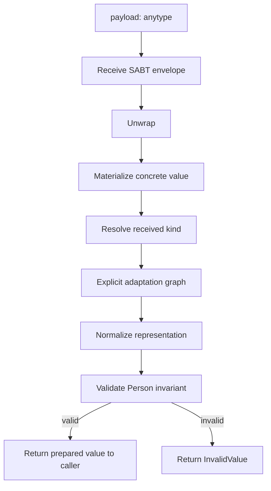
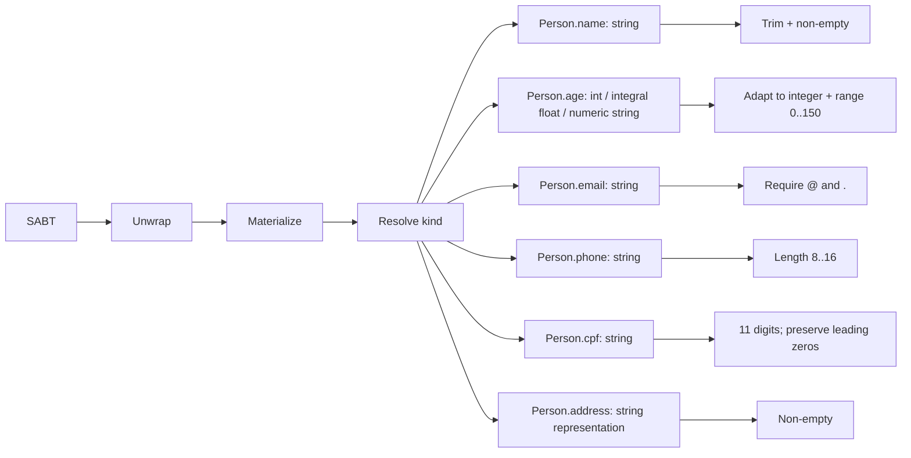

# SABT Person Materialization Graph

The entry point is generic: `payload: anytype`. It does not enforce the consumer's domain schema at the transport boundary. If the payload is a SABT envelope, the envelope is unwrapped first; only then are its value kind and the consumer's expected field compared.

## Pipeline

## Person field paths

The current implementation is intentionally conservative: age has explicit numeric adaptation; the other Person fields accept string representations and reject implicit numeric-to-string coercion. In particular, an integer cannot be safely converted back into a zero-padded CPF. Address objects/JSON decoding, full CPF checksum verification, richer email/phone parsing, and allocator-owned materialization are follow-up adapters, not claimed as implemented here.

## Semantics

- `unwrap` removes the SABT envelope; it is not schema validation.
- `materialize` creates a concrete value representation.
- `resolve kind` describes what actually arrived.
- `adapt` traverses only explicitly allowed conversion edges.
- `normalize` canonicalizes representation without asserting domain validity.
- `validate` checks the target field's current invariant; `prepare` invokes it and returns `InvalidValue` when the invariant fails.
- Successful `prepare` results are marked `Stage.validated`; invalid prepared values are not returned.
- The runtime remains the authority for Action execution and final test outcomes. The current validation error is typed but does not yet carry structured evidence describing which invariant failed.
